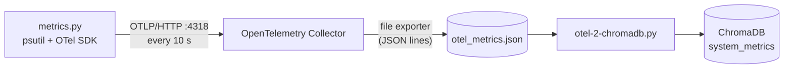

# AIOps

An experimental pipeline that collects host metrics from a Mac with OpenTelemetry and loads them into a [ChromaDB](https://www.trychroma.com/) vector store. It's a starting point for AIOps experiments: getting operational telemetry into a form that can be searched by similarity or fed to an LLM.

## How it works



1. **`metrics.py`** reads CPU and memory usage with `psutil` and exports them as OpenTelemetry gauges to a collector every 10 seconds.
2. The **OpenTelemetry Collector** receives them over OTLP/HTTP and writes each batch as a line of OTLP JSON to `otel_metrics.json`.
3. **`otel-2-chromadb.py`** reads that file, turns each data point into a small vector and stores it in the `system_metrics` ChromaDB collection.

## Repository contents

| File | Purpose |
|---|---|
| `metrics.py` | Sends this machine's CPU and memory usage to an OpenTelemetry Collector. |
| `otel-2-chromadb.py` | Loads the collector's JSON output into ChromaDB. |
| `otel-collector-config.yaml` | Example collector config: receives OTLP/HTTP, writes `otel_metrics.json`. |
| `requirements.txt` | Python dependencies for both scripts. |

## Metrics collected

| Metric | Instrument | Unit | Attributes | Source |
|---|---|---|---|---|
| `system.cpu.usage` | Observable gauge | percent | none | `psutil.cpu_percent()` |
| `system.memory.usage` | Observable gauge | bytes | `state`: `used` or `total` | `psutil.virtual_memory()` |

All metrics carry the resource attribute `service.name=macbook-metrics` and come from the meter `macbook.meter`.

## Prerequisites

- Python 3.9 or later
- Docker, to run the collector (or the `otelcol-contrib` binary). The file exporter is only in the **contrib** distribution of the collector, not the core one.

## Setup

```bash
git clone https://github.com/bluefogtech/AIOps.git
cd AIOps
python3 -m venv .venv
source .venv/bin/activate
pip install -r requirements.txt
```

## Running

Run each step in its own terminal from the repository folder.

**1. Start the collector**

```bash
docker run --rm -p 4318:4318 \
  -v "$(pwd)/otel-collector-config.yaml:/etc/otelcol-contrib/config.yaml" \
  -v "$(pwd):/data" \
  otel/opentelemetry-collector-contrib:latest
```

The collector writes `otel_metrics.json` into the repository folder. Its `debug` exporter also logs a line for every batch it receives, which is a quick way to confirm metrics are arriving.

To use the `otelcol-contrib` binary instead of Docker, change the file exporter's `path` in `otel-collector-config.yaml` to `./otel_metrics.json` and run:

```bash
otelcol-contrib --config otel-collector-config.yaml
```

**2. Start sending metrics**

```bash
python metrics.py
```

This keeps running and exports every 10 seconds. Press Ctrl+C to stop.

**3. Load the metrics into ChromaDB**

```bash
python otel-2-chromadb.py
```

This processes the whole of `otel_metrics.json` once and exits. Please read [Known issues](#known-issues) before relying on its output.

## Configuration

Settings are hard-coded. Edit the scripts to change them.

| Setting | Where | Default |
|---|---|---|
| Collector endpoint | `OTEL_COLLECTOR_URL` in `metrics.py` | `http://localhost:4318/v1/metrics` |
| Export interval | `export_interval_millis` in `metrics.py` | `10000` (10 s) |
| Service name | `Resource.create(...)` in `metrics.py` | `macbook-metrics` |
| Input file | last line of `otel-2-chromadb.py` | `otel_metrics.json` |
| ChromaDB directory | `persist_directory` in `otel-2-chromadb.py` | `./chroma-metrics` |
| Collection name | `get_or_create_collection(...)` in `otel-2-chromadb.py` | `system_metrics` |

## What gets stored in ChromaDB

Each metric data point becomes one record in `system_metrics`:

| Field | Value | Example |
|---|---|---|
| `id` | `<metric name>_<unix seconds>` | `system.cpu.usage_1748246400` |
| `document` | `<metric name>: <value>` | `system.cpu.usage: 12.5` |
| `metadata` | `{"timestamp": <unix seconds>}` | `{"timestamp": 1748246400}` |
| `embedding` | 3 numbers built by `metric_to_vector()` | `[0.42, 0.125, 0.2464]` |

The embedding is hand-built rather than produced by an embedding model:

1. the metric name's hash, scaled to 0–1
2. the value divided by 100
3. the timestamp's position within a 1,000,000-second (about 11.5-day) window, scaled to 0–1

## Known issues

These turned up while the code was being reviewed for this documentation. They have not been fixed yet.

1. **No data points are read from real collector output.** In OTLP JSON, data points sit under the metric's type, for example `metric["gauge"]["dataPoints"]`. The loader reads `metric["dataPoints"]`, which doesn't exist, so it stores nothing.
2. **ChromaDB data isn't saved to disk.** In ChromaDB 0.4 and later, `chromadb.Client(Settings(persist_directory=...))` creates an in-memory client, so the collection disappears when the script exits. `chromadb.PersistentClient(path="./chroma-metrics")` keeps it.
3. **Memory `used` and `total` overwrite each other.** Both data points have the same metric name and timestamp, so they get the same ID and only one is kept. The `state` attribute isn't stored either.
4. **Vectors aren't comparable across runs.** Python randomises `hash()` for strings in each process, so the first component changes every run. Memory values in bytes, divided by 100, are also far larger than the other components and swamp them.
5. **The first CPU reading is always 0.** `psutil.cpu_percent()` returns a meaningless `0.0` the first time it's called.

## Troubleshooting

- **The collector logs nothing after `metrics.py` starts.** Check the collector is running and port 4318 is published (`-p 4318:4318`). `metrics.py` only exports every 10 seconds, so give it a moment.
- **"No metrics file found."** `otel-2-chromadb.py` looks for `otel_metrics.json` in the folder you run it from. Run it from the repository folder, after the collector has received at least one batch.
- **The collector can't write `otel_metrics.json` (Linux).** The collector image runs as a non-root user. Add `--user "$(id -u):$(id -g)"` to the `docker run` command, or make the folder writable.
